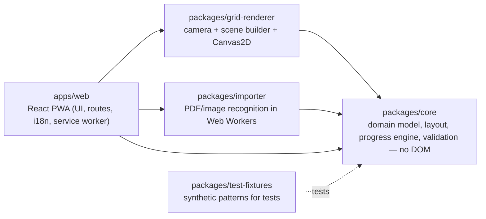

# KnittingTracker

A local-first web app (PWA) for **phone, tablet and desktop** that keeps track of knitting progress
on charts. All charts of a round or row are shown side by side in one grid, and progress is a single
position in the continuous sequence of stitches: tap a stitch, and it and everything before it are
done. The UI is in Polish by default, with English available.

> **Status:** 1.0.0. Pattern import from PDFs and photos with a verification screen, a chart
> editor and layout wizard, stages (round and flat, continuing charts, open-ended stages, row
> counters), progress tracking that works offline, backups. What was and was not verified:
> [`docs/release-1.0.md`](docs/release-1.0.md).

Your data stays on your device. There is no account, no server-side storage and no telemetry. Pattern
files you import are copyrighted by their authors, so they are never uploaded anywhere.

## Quick start (development)

Requirements: **Node.js ≥ 22.12** (24 LTS recommended, see `.nvmrc`) and **pnpm 10** (via corepack).

```bash
corepack enable
pnpm install
pnpm dev                # http://localhost:5173
```

| Command                                        | What it does                                                                                |
| ---------------------------------------------- | ------------------------------------------------------------------------------------------- |
| `pnpm dev`                                     | Vite dev server with hot reload                                                             |
| `pnpm --filter @kt/web dev:https`              | Dev server with a self-signed certificate on your LAN (needed by phones, see below)         |
| `pnpm test` / `pnpm test:coverage`             | Unit and component tests (Vitest). `@kt/core` must stay ≥ 90% covered                       |
| `pnpm lint` · `pnpm typecheck` · `pnpm format` | ESLint, TypeScript (strict), Prettier                                                       |
| `pnpm build` · `pnpm preview`                  | Production build (with service worker) and a local preview on :4173                         |
| `pnpm e2e`                                     | Playwright on 4 viewports (iPhone/WebKit, Android, tablet, desktop). Run `pnpm build` first |
| `pnpm check:bundle`                            | Startup JavaScript budget (after `pnpm build`)                                              |
| `pnpm ci:local`                                | Everything CI runs, in order                                                                |

First-time Playwright setup: `pnpm --filter @kt/web exec playwright install chromium webkit`.

## Running the production build (Docker)

```bash
docker compose --profile prod up --build      # http://localhost:8080 (healthcheck: /healthz)
```

The image is a two-stage build: Node builds `dist/`, and the result is served by
`nginx-unprivileged` (non-root, port 8080, read-only root filesystem). It sets a strict
Content-Security-Policy and security headers, caches hashed assets for a year, and always
revalidates `index.html`, `sw.js` and the manifest. Docker is only for **serving** the app. Phones
use the PWA from the browser and don't need it.

## Using it on a phone

Service workers, the screen Wake Lock and persistent storage need a **secure context** (HTTPS or
`localhost`). On your LAN:

1. `pnpm build && pnpm --filter @kt/web preview:https` (production build, works offline once
   installed). Use `pnpm --filter @kt/web dev:https` (or `docker compose --profile dev up`) for
   development with hot reload. The dev server has no service worker.
2. Open `https://<your-computer's-LAN-IP>:4173` (preview) or `:5173` (dev) on the phone and accept
   the self-signed certificate warning. Then use the browser's "Add to Home Screen" (iPhone: Share →
   Add to Home Screen; Android: menu → Install app). On iPhone, the home-screen app has **its own
   storage**, separate from Safari tabs, so create your projects in the installed app.
3. If a browser refuses to run the service worker with a self-signed certificate, use USB port
   forwarding instead: Chrome on Android via `chrome://inspect` → _Port forwarding_ → `5173`, then
   open `http://localhost:5173` on the phone.

## Your own pattern files

The app opens `*.ktpattern.json` files ([format](docs/pattern-format.md)). Files stay on the
device. To get a file onto a phone, AirDrop/share it and pick it in **Nowy projekt → Wybierz plik
wzoru**. A private pattern kept in the git-ignored `local/` folder (e.g. a golden copy of a real
pattern) is loaded the same way and never becomes part of the build.

## Building a pattern in the app

**Wzory → Nowy wzór** starts an empty pattern. On the pattern page you set the name, sizes, charts,
stages and the legend; a check at the bottom lists problems with a link to the chart or layout
that has them. **Dodaj schemat** opens the chart editor: pick a symbol and draw (tap or drag),
select a rectangle to copy, paste, fill or mirror it, and change the size. **Ustaw układ** opens the
layout wizard: put the charts in the order of the pattern text, set partial repeats ("A.1 over 22
stitches") per size, add markers for front and back, and compare the stitch count with the
pattern. **Zacznij dziergać** creates a project; **Zapisz do pliku** exports the pattern.

## Stages, finishing and backups

A pattern can have several **stages** (e.g. body in the round, then front and back flat). In the
stage editor a chart can **continue as in an earlier stage**: after the split, the front's A.2 starts
with the row after the last one knitted in the body. **Zmiana układu** on the pattern page creates
such a continuing stage, for decreases or increases from a given row. A stage can be **open-ended**
("until 34 cm"): with the gauge (in the pattern, or your own in the project settings) the app
estimates the rows left, and you end it with **Zakończ etap**, which shows the chart rows of the
last row so you can check them against the pattern. Ribbing and plain sections can use a **row
counter** instead of tapping stitches.

If you knitted without the app, **Ustaw** next to the position (or the G key) sets the row and the
stitches done in it. This can be undone.

**Ustawienia → Zapisz kopię zapasową** saves everything to one file; **Przywróć z kopii** reads it
back on any device. Before writing, it shows what is new, what is newer in the backup and what is
newer on this device; newer work on the device is never overwritten.

## Importing a pattern from a PDF or a photo

**Wzory → Rozpoznaj z PDF lub zdjęcia** reads a pattern PDF, a screenshot, a scan or a photo of a chart. Everything
happens on the device, in a background worker; the file is never uploaded. For a photo you first
drag the four corners onto the chart. Then you check what was found:

- **Legend**: each symbol from the file is matched with a symbol of the app. Fix a wrong match and
  press **Rozpoznaj ponownie z tymi symbolami**.
- **Charts**: the original is shown next to the recognised grid. Doubtful cells are outlined; **Następna
  niepewna kratka** jumps to the next one, and you confirm it or pick another symbol (also with the
  arrow keys, Enter and 1–9). Give each chart its name from the pattern (e.g. A.1).
- **Description**: sizes, the order of the charts, stitch counts and the marker are read from the
  pattern text (from the same PDF, or add the description PDF separately). Correct anything that
  is wrong.

**Utwórz wzór** creates a normal pattern that you can still edit and lay out before you start
knitting. Limits: 25 MB per file, 30 PDF pages, 40 megapixels per image. Recognition works best on
PDFs and sharp, evenly lit photos; always compare the result with the original.

## Architecture



| Path                                    | Purpose                                                                                                                                                                                                                                                                    |
| --------------------------------------- | -------------------------------------------------------------------------------------------------------------------------------------------------------------------------------------------------------------------------------------------------------------------------- |
| `apps/web`                              | The PWA: screens, state, storage adapters, service worker, e2e tests                                                                                                                                                                                                       |
| `packages/core`                         | Pure TypeScript domain logic. ESLint and tsconfig forbid DOM and UI imports                                                                                                                                                                                                |
| `packages/grid-renderer`                | Grid rendering (tiled Canvas2D), testable without a browser                                                                                                                                                                                                                |
| `packages/importer`                     | Local pattern import (pdf.js, raster recognition). Never uploads files                                                                                                                                                                                                     |
| `packages/test-fixtures`                | Self-authored synthetic charts. Never third-party material                                                                                                                                                                                                                 |
| `docs/`                                 | [Analysis](docs/00-analysis.md), [ADRs](docs/adr/README.md), [file format](docs/pattern-format.md), [design](docs/design.md), [security](docs/security.md), [accessibility](docs/accessibility.md), [performance](docs/performance.md), [release 1.0](docs/release-1.0.md) |
| `docker/`, `Dockerfile`, `compose.yaml` | Static hosting image and local environments                                                                                                                                                                                                                                |

Decisions and their reasons are recorded in [`docs/adr/`](docs/adr/README.md).

## Configuration

Only build-time flags exist (see [`.env.example`](.env.example)). Copy it to `.env.local` to override
locally. There are no secrets in v1.

| Variable             | Default | Meaning                                                             |
| -------------------- | ------- | ------------------------------------------------------------------- |
| `VITE_APP_ENV`       | `dev`   | `dev` · `test` · `prod`. Non-prod builds show an environment footer |
| `VITE_ENABLE_VISION` | `false` | Reserved for an opt-in vision-model recognizer (not built yet)      |

## Copyright and privacy

Knitting patterns (e.g. DROPS) are protected by copyright, and their authors forbid publishing
pattern descriptions online. Therefore:

- `inspirations/` (reference material) and `local/` (private golden data) are git-ignored, and
  `pnpm check:forbidden` (pre-commit and CI) blocks them and copied pattern wording.
- Tests use **synthetic** charts from `packages/test-fixtures`. Tests based on real patterns read from
  `local/` and skip themselves when the data is absent.
- The app has no public pattern library, no sharing and no third-party requests at runtime.

## Contributing

See [CONTRIBUTING.md](CONTRIBUTING.md).
