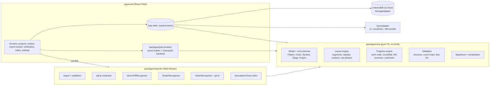

# KnittingTracker — Phase 0: Analysis, Requirements, Risks and ADRs

| | |
|---|---|
| Status | **Proposed**. Waiting for owner approval. Decisions marked *(default)* apply if a question stays unanswered. |
| Date | 2026-10-15 |
| Branch | `feat/phase-0-analysis` |
| Scope | Phase 0 only. No application code. |

> **Copyright note for this document.** This file is committed to the repository, so it contains **no
> DROPS pattern text, chart transcription, legend wording or per-size stitch lists**. Pattern facts
> appear only at the level the specification already uses (e.g. "262 stitches, markers at 131",
> chart dimensions). The detailed data stays in `inspirations/` and `local/`, and both are git-ignored.

---

## 0. TL;DR

- **Product**: a local-first PWA (phone, tablet, desktop) that shows all charts of a round/row side by side
  in one canvas-rendered grid and tracks progress as **one position in a continuous stitch sequence**.
  Import goes from PDF/image to a verified grid. A full manual chart editor exists as a first-class path.
- **Stack** *(proposed)*: TypeScript strict, pnpm monorepo, Vite, React + React Aria Components,
  Canvas 2D tiled renderer, Dexie/IndexedDB, Workbox PWA, pdf.js in a Web Worker, zod, Vitest +
  fast-check, Playwright + axe. Static nginx-unprivileged Docker image. **No backend in v1.**
- **Material findings that change the design** (details in §2):
  1. The chart transcription in `prompt_to_sample_app.txt` **matches the chart image in
     `DROPS 246-2.pdf`**. I checked it programmatically, not by eye: grid sizes, every knit/purl cell
     outside cable rows, the orientation of all 81 multi-cell symbols, and stitch flow between rows.
  2. The original **A.1 is not plain knit**. It is a small 3×9 texture chart. Knitting A.1 as plain knit
     is the knitter's **own modification**, so the data model needs **per-project pattern
     modifications** (the pattern stays faithful, the project overrides it).
  3. The pattern requires features the spec mentions only implicitly: a **partial horizontal
     repeat** (a filler "over N stitches, ending with the first stitch of the chart"), **chart row
     phases that continue across stages** (the split continues "as before"), **open-ended stages
     measured in cm**, a **first flat row on the wrong side**, **bind-offs and increases that change
     row width**, and **chart content overridden for part of a stage**.
  4. The spec's consistency rule "consumed = produced in every row" holds only for rows without
     shaping. The correct invariant is a **stitch-count chain**: what row *r* produces equals what row
     *r+1* consumes, and every symbol has a known consumes/produces pair. A **stitch-flow lint**
     (knit/purl continuity through cables) is a strong extra check, and it also finds recognition
     errors.
  5. The raster recognizer is feasible for this file type. A ~40-line projection-profile spike found
     all four grids with exact dimensions (44×20, 14×22, 8×9, 3×9) at about 10.7 px per cell.
     Chart **names and width labels are pixels, not text**, so without OCR the user confirms names.
- **Spec versions differ.** The project copy of the prompt (claude.ai Project
  `claude/prompt-opus-knitting-tracker.md`) is a **superset** of the untracked `PROMPT.md` in the repo.
  It adds F4 (frontend/design), the mandatory `DROPS 246-2.pdf` importer acceptance test and two
  Definition-of-Done items. This analysis follows the **superset** *(default, see Q1)*.

---

## 1. Inputs reviewed

| Input | What it is | How I reviewed it |
|---|---|---|
| `PROMPT.md` (repo, untracked) | Specification, older/shorter variant | Read in full |
| Project doc `claude/prompt-opus-knitting-tracker.md` | Specification, superset (adds F4, importer acceptance, DoD items) | Read in full, diffed against `PROMPT.md` |
| `inspirations/prompt_to_sample_app.txt` | Description of the prototype, layout math, symbol table, chart transcription, known gaps | Read in full. Transcription ported to a throwaway script |
| `inspirations/Ocean Ropes M – siatka.html` | Prototype: one HTML file, a single SVG rebuilt via `innerHTML`, `localStorage` | Read in full (≈9 kB) |
| `inspirations/DROPS 246-2.pdf` | 2-page A4 print of the chart page | `pdfinfo`, `pdffonts`, `pdfimages`, `pdftotext`, rasterized at 150 dpi, viewed, legend icons extracted and enlarged, chart image analysed with a Python spike (§2.3) |
| `inspirations/Ocean Ropes _ DROPS 246-2 - …pdf` | 1-page (2874×13856 pt) print of the main pattern page | Same tools. Text layer read in full, image list checked |

The spike scripts stay in a scratch area outside the repo, because they embed the transcription.
They are evidence for this analysis, not deliverables.

---

## 2. Findings from the materials

### 2.1 `DROPS 246-2.pdf` (chart print)

- Producer: Skia/PDF (Chromium-based browser "Print to PDF"). 2 A4 pages.
- **Page 1**: the legend. 9 tiny **raster icons**, each with a soft mask, at **10 px per cell**
  (widths 10, 10, 20, 20, 20, 30, 30, 40 px, plus a 9 px star used for assembly). Each icon sits
  on the same baseline as a text line in the text layer, so icon↔description pairing by y-coordinate
  is trivial. **The text layer has no DROPS symbol numbers.** The numbers in the prototype
  (1, 21, 201, …) came from the website's image file names. → *symbol number is optional
  metadata, never the key*.
- **Page 2**: **one JPEG (501×600 px)** with all four charts (A.4 top, A.2/A.3/A.1 below), the
  chart names and the width brackets ("44", "14", "8"), all as pixels. A second JPEG (500×348 px) is
  the assembly sketch. **No text layer and no vector paths for the charts.** → vector extraction
  does not apply. Names and widths need OCR or user confirmation.
- Measured cell pitch: 10.5–11 px (≈10.7 px) for all charts. JPEG artefacts are mild. Grid lines
  are gray, symbols are black, and the purl dash is a short black bar centred in the cell.

### 2.2 Main pattern page PDF (description)

- One very tall page with a full text layer (Lato fonts). The legend icons repeat at a different scale.
  **No chart images** (confirmed: the image list contains photos, legend icons and the sketch only).
- Structural facts relevant to the model (paraphrased):
  - 6 sizes. Every quantity is a hyphen list with one value per size.
  - Separate gauges for stockinette and for the A.1 texture, plus a width for the cable panel.
  - Charts show **all rows from the right side**, which confirms the RS-view convention.
  - The body starts with ribbing and garter ridges measured in **cm**, with a small even decrease.
    Markers at the start of the round and at the half (sides).
  - Round layout: filler A.1 over N stitches, then a 5-chart panel, filler A.1 over M stitches, the
    panel again, filler A.1 over K stitches. **Fillers can end on a partial repeat** ("end with the
    first stitch of A.1"). For size M the values give 262 stitches, consistent with the prototype.
  - The body is worked to a length in **cm**, then the split round must be an **odd chart round**. It
    **binds off** stitches at both underarms and then continues **flat**, back first. The **first
    flat row is a WS row**, and the charts continue "as before" (row phase continuity).
  - The front gets **even decreases over the A.4 stitches**, then **A.4 loses its cables** (A.4
    stitches become plain purl on RS), then neckline bind-offs at the beginning of rows.
  - Sleeves: worked in the round in A.1 with **paired increases around a marker stitch** (the new
    stitches join the A.1 texture), then split and worked flat for a short distance.
  - Neckband: picked up stitches, simple rib, length in cm.
- The copyright notice at the bottom prohibits distributing the pattern descriptions online. This
  confirms the privacy/copyright requirements.

### 2.3 Transcription vs. chart image (programmatic check)

I wrote a throwaway Python spike with no OpenCV, only numpy projection profiles:

1. **Grid detection**: columns/rows with more than 75% dark pixels inside a chart's bounding box
   are grid lines. Result: **A.4 44×20, A.2 14×22, A.3 8×9, A.1 3×9**, all exact on the first try.
2. **Cell classification** (heuristic): empty / centred dash / "ink" (line or fill).
   Outside cable rows, **every cell agrees with the transcription**.
3. **Multi-cell symbols**: for each symbol position from the transcription, I fitted the dark pixels
   inside its span (grid lines excluded). I checked the slope sign for 2/4-cell crossings, the apex
   position for 3-cell carets and the fill side for the solid triangle. **81 of 81 symbols agree**
   (71 in A.4, 10 in A.2).
4. **Stitch-flow check**: each cable symbol was modelled as a knit/purl permutation (e.g. a 2-cell
   crossing p,k → k,p). The output of row *r* was compared with the input of row *r+1*, including
   the wrap from the last row back to row 1. **A.2 and A.4 are fully consistent.** A.3 differs only on
   its purl-ridge rows, which are intended texture changes.

**Conclusion:** I found no discrepancies in A.2–A.4. The transcription is correct as far as these
checks can tell. A.1 in the transcription ("plain knit") is **not the chart**: the real A.1 is a
3×9 knit/purl texture. The prototype documents this as the knitter's choice. The golden data
must therefore contain the **real A.1** and a **project-level override** "A.1 → knit".

The legend icons also confirm the prototype's *corrected* legend: "\" belongs to the
front-held 1/1 crossing, "/" to the back-held 1/1 crossing, the caret with the longer left arm to
the 3-cell back-held crossing, and the caret with the longer right arm to the 3-cell front-held
crossing. The prototype's drawn glyphs were already right; only its legend text had been wrong.

### 2.4 Prototype review

Keep:
- Progress as one integer `D` (stitches done in work order), eraser, undo stack (300), status
  line, preserved scroll position, light/dark theme via CSS variables, legend drawn with the same
  glyph code as the grid.
- Layout: the round as one strip, **Back on the left and Front on the right** (the RS view of a
  round worked right to left), with a gap between halves. Zone header, stitch numbers every 10, row
  numbers. Stitch numbering: **stitch 1 = first stitch of the round** (Front 1–131, Back 132–262).
  **The new app must keep exactly this numbering**, so the knitter can carry her current position over
  by typing "row R, stitch S" from the prototype's status line.

Fix:
- The whole SVG is rebuilt via `innerHTML` on every tap, which is O(cells) per interaction and does
  not scale to 500×300.
- Hit-testing duplicates layout constants (`W`, `G`, `T`) in two places.
- The visible row count is capped (1–80) and charts are cut at that cap without any mark (A.2 at 20 rows).
- No redo, no "complete row", no keyboard support, no ARIA, and progress is shown by colour only.
- Charts are hard-coded functions. There are no stages, no flat knitting and no sizes.
- Progress lives in `localStorage` on the artifact's origin. **The new app cannot read it** (different
  origin), so migration is manual: "set position".

### 2.5 Spec gaps and corrections

| # | Spec statement | Issue | Resolution |
|---|---|---|---|
| G1 | "in every row consumed = produced" | False for rows with bind-offs, decreases or increases | Invariant = **stitch-count chain** (row *r* produced = row *r+1* consumed). Per-symbol consumes/produces are declared. Cables are 1:1 by definition |
| G2 | "Postęp is one position in a continuous sequence" | Undefined for symbols that consume ≠ 1 stitch | Progress unit = **worked cell** (one tap per chart cell, in work order). Width-changing symbols still occupy one cell each |
| G3 | "progress is a monotonic counter" (sync) | Eraser and undo move backwards on purpose | Sync conflict model uses revisions/ancestry, not `max()` (ADR-4) |
| G4 | "symbols swap meaning on WS" | Cables on WS rows need their own instruction. In the reference pattern every cable is on an odd (RS) row | Each symbol declares a `ws` behaviour: `invert` (k↔p), `explicit` (own WS text), or `unsupported` → validation warning |
| G5 | "visible rows = configurable or until end of stage" | Many stages end at a length in cm, so the row count is unknown | Stage end types: `rows`, `repeats`, `openEnded` (with a gauge estimate). The grid always shows complete chart repeats and marks "continues…" |
| G6 | Two spec versions | `PROMPT.md` lacks F4 and the importer acceptance criteria | Follow the superset (Q1) |

---

## 3. Requirements

IDs: `FR-*` (from the spec), `DR-*` (derived from the materials), `NFR-*` (quality). Every
milestone acceptance test refers to these IDs.

### 3.1 Functional — from the spec (condensed)

| ID | Requirement |
|---|---|
| FR-1 | Import wizard: PDF / image / screenshot / blank → detect charts, legend, layout text, sizes → **verification screen** (original next to the grid, low-confidence cells highlighted, fast correction) → round layout setup (size, order, filler widths, markers) → tracking |
| FR-2 | `ChartRecognizer` interface with (a) vector PDF, (b) raster with legend-template and built-in-library matching, (c) optional vision model (off by default, opt-in, user's own key). **Per-cell confidence** in every result |
| FR-3 | All import processing runs locally in Web Workers. No upload |
| FR-4 | Description parser (PL first, EN pluggable) for sizes, chart order and filler counts. Heuristic and always editable |
| FR-5 | Full chart editor: palette, paint, select, copy/paste, mirror, resize |
| FR-6 | Extensible symbol library (DROPS numbering + standard symbols). Each symbol has id, number, width, consumes/produces, description, glyph, WS behaviour |
| FR-7 | Versioned JSON export/import of patterns (zod-validated) |
| FR-8 | One grid with all charts side by side for the whole round. **500 stitches × several hundred rows at ≈60 fps** on a mid-range tablet |
| FR-9 | Row 1 at the bottom. Independent vertical repeats per chart. Nothing cut off without a visible mark |
| FR-10 | Zone labels, stitch numbers, marker segments (Front/Back), row numbers |
| FR-11 | Zoom/pan via pinch, wheel, keyboard and slider. Square cells |
| FR-12 | Progress = single position. Tap marks the stitch and everything before it. Eraser toggle. Undo/redo (≥300, persisted). "Complete row". Keyboard shortcuts. Current row and last stitch highlighted. Auto-scroll. Status text, % of stage, row/round counters |
| FR-13 | Round and flat knitting. Flat alternates direction, WS rows reverse order and invert symbols |
| FR-14 | Stages with their own layouts. Layout changes from a given row (increases/decreases) |
| FR-15 | Legend under/next to the grid, using the same glyphs and the pattern's own descriptions |
| FR-16 | Ergonomics: ≥44 px targets, Wake Lock, light/dark/system theme, responsive phone/tablet/desktop in both orientations, safe-area insets |
| FR-17 | Accessibility: WCAG 2.2 AA, state not conveyed by colour alone, full keyboard support, labelled controls |
| FR-18 | UI in Polish by default, i18n-ready (pl, en). Code and technical docs in English |
| FR-19 | Local-first storage, Pattern/Project split (1 pattern → N projects), versioned schema with tested migrations, file backup, `SyncAdapter` interface with a local implementation, storage always in try/catch, works without storage (with a warning), `navigator.storage.persist()` |
| FR-20 | F4 design goals: warm, calm, crafted look, a token-based design system, the grid as the hero, real-world legibility, layouts per form factor, polished non-grid screens, restrained motion, onboarding with a **synthetic** sample pattern, screenshots of 3 viewports × 2 themes in every UI milestone report |

### 3.2 Functional — derived from the materials

| ID | Requirement | Source |
|---|---|---|
| DR-1 | **Per-project modifications**: substitute a chart (e.g. "A.1 → plain knit"), override cells for a stage/segment, without editing the pattern | Knitter's actual A.1 choice; front "A.4 without cables" |
| DR-2 | **Horizontal repeat with partial repeat and alignment**: "chart X over N stitches, ending with the chart's first-worked stitch" | Filler A.1 (N not divisible by 3) |
| DR-3 | **Chart row-phase continuity**: a chart placement keeps its vertical phase across stages and layout changes ("continue as before") | Split into front/back, sleeves |
| DR-4 | **Stage start constraints**, e.g. "the next row must be an odd chart row". The app shows how many rows remain until the constraint holds | Split round parity |
| DR-5 | **Open-ended stages** ("until X cm") with a gauge-based row estimate and a manual "finish stage" | Body, sleeves, neckband |
| DR-6 | **Rows of varying width**: bind-off and increase symbols, "no stitch" cells, pattern growth around a marker stitch (new stitches join the filler texture) | Underarm bind-offs, sleeve increases, neckline |
| DR-7 | **First flat row can be WS**. Every stage defines the side of its first row | Back/front after split |
| DR-8 | **Manual position entry** ("row R, stitch S") using the prototype's numbering. Also used after knitting away from the app | Migration from the prototype |
| DR-9 | Simple stitch patterns (1×1 rib, garter) can be stages, either as tiny charts or in **row-counter mode** (count rows only, no per-stitch taps) | Ribbing and garter sections |
| DR-10 | Symbol number is optional metadata. Identity = library id. Legend pairing comes from document geometry | Chart PDF has no numbers |
| DR-11 | Glyph = **single source of truth** for grid, legend, editor palette and recognizer templates, so the prototype's legend/grid divergence cannot happen again | Prototype legend bug |
| DR-12 | **Text instructions for the current row** generated from the chart (run-length, e.g. "p6, C201, …", reversed and inverted on WS). Doubles as the screen-reader view | Accessibility of a canvas grid |
| DR-13 | **Segment focus** on phones: show one marker segment (e.g. Front only) at full cell size | 131-stitch halves on a phone screen |
| DR-14 | Gauge mismatch warning when a modification changes width (e.g. texture → stockinette) is **backlog**. Stitch re-counting for a different gauge is out of scope | Prototype note, spec out-of-scope list |

### 3.3 Non-functional

| ID | Requirement |
|---|---|
| NFR-1 | TypeScript `strict` everywhere. `core` has zero DOM/UI dependencies (enforced by tsconfig `lib` and an ESLint import rule) |
| NFR-2 | `core` coverage ≥ 90% (lines and branches) |
| NFR-3 | Performance budget (mid-range tablet, 4× CPU throttle in CI as a proxy): first paint of a 500×300 grid ≤ 150 ms. Pan/zoom frames ≤ 16 ms (p95). Tap → visual feedback ≤ 50 ms. Progress write ≤ 20 ms |
| NFR-4 | Offline: everything except the optional vision adapter works with no network after first load |
| NFR-5 | Security: strict CSP, no `eval`, no `innerHTML` from file data, upload validation (magic bytes, ≤ 25 MB, ≤ 30 PDF pages, ≤ 40 MP images), PDF parsing in a worker, pinned dependencies, `pnpm audit` in CI |
| NFR-6 | Privacy: no telemetry without opt-in. No third-party runtime requests (fonts self-hosted). No DROPS material in the repo, image or logs |
| NFR-7 | Browser support: current and previous major versions of Safari iOS/iPadOS (≥ 17), Chrome/Edge, Firefox. ES2022 target |
| NFR-8 | Data durability: progress survives reload, offline use, app update (SW update must not lose state) and schema migration |

---

## 4. Assumptions

| ID | Assumption | Impact if wrong |
|---|---|---|
| A-1 | Charts are drawn as the RS view, showing all rows (the pattern states this for DROPS) | Patterns with "RS rows only" charts need a per-chart `rowsShown: 'all' \| 'rsOnly'` flag. Planned as a field, not implemented in v1 |
| A-2 | Storage convention: chart columns numbered **left→right as drawn**, rows bottom→top. Work order is always derived, never stored | — |
| A-3 | Cables appear only on RS rows in supported patterns. WS cables need `ws: explicit` | Warning shown, the user supplies WS text |
| A-4 | One person, several devices, never two people on one project at once | Sync conflict model would need CRDTs |
| A-5 | Pattern files are the user's own copies for personal use and stay on their devices | — |
| A-6 | The knitter is on the body (in the round) of size M with A.1 knitted as plain knit *(default of Q2)* | Milestone order may change |
| A-7 | Golden data (Ocean Ropes transcription → pattern JSON) lives in git-ignored `local/` and reaches the knitter's device as a private file (AirDrop/share), never via the build | — |
| A-8 | Hosting has HTTPS (required for service workers, Wake Lock and persistent storage on real devices) | LAN testing needs a local TLS setup |

---

## 5. Risks

| ID | Risk | L | I | Mitigation |
|---|---|---|---|---|
| R-1 | Raster recognition quality on photos (perspective, lighting, blur). Low-resolution screenshots | H | M | Wizard "crop & straighten" step (4 draggable corners + homography). Adaptive threshold. Per-row dynamic-programming segmentation. Flow lint highlights suspicious cells. The editor is first-class. Expectations: clean prints work well, photos need more correction |
| R-2 | Stage and shaping complexity (bind-offs, increases into texture, neckline) grows unbounded | H | H | v1 scope: stages + layout patches at row boundaries + "no stitch" cells + per-stage overrides. Complex shaping is drawn as a shaping chart in the editor. Automating "evenly decrease N" is backlog |
| R-3 | iOS Safari: storage eviction for non-installed sites after 7 days without use. **Separate storage for Safari tab vs. home-screen PWA.** Historic Wake Lock bugs in standalone mode | M | H | Onboarding nudges to install *before* creating a project. `persist()`. Visible "last backup" indicator with one-tap export/share. Wake Lock with graceful fallback and re-acquire on `visibilitychange` |
| R-4 | A canvas grid is opaque to assistive technology | M | M | Keyboard cursor, aria-live status, DR-12 text row view, accessible controls via React Aria. axe tests on all non-canvas UI |
| R-5 | DROPS content leaking into the repo, Docker image, visual-regression snapshots or logs | M | H | `.gitignore` (`inspirations/`, `local/`). Visual/E2E tests use **synthetic patterns only**. A pre-commit and CI "forbidden paths/content" check. Golden tests skip themselves when data is absent. Logger never prints pattern content |
| R-6 | Low-end Android tablet performance | M | M | Tile cache, LOD below 6 px/cell, OffscreenCanvas worker rasterization as an optional step, CPU-throttled perf test in CI |
| R-7 | Timeline pressure: the knitter needs M2 soon, while production quality requires tooling | H | M | M0 kept lean (only what M1/M2 need). Importer and editor after M2. Earlier "Ocean Ropes flat stages" slice if the split is near (Q2) |
| R-8 | CI cannot be verified (no push allowed) | H | L | Run every CI step locally with the same scripts (`pnpm ci:local`). Workflow YAML linted with `actionlint`. CI marked "unverified" in reports until pushed |
| R-9 | Spec divergence (two prompt versions) | M | M | Q1. This document records which version is followed |
| R-10 | Undo/eraser semantics vs. multi-device sync | L | M | Revision ancestry plus an explicit user choice on true conflicts (ADR-4) |
| R-11 | pdf.js weight (≈1 MB+) and worker/CSP quirks on Safari | M | L | Lazy-load only in the import route. `isEvalSupported: false`, no scripting. Test CSP in Safari |

---

## 6. Architecture overview



Repository layout (M0):

```
apps/web/                 React PWA (Vite), routes, components, i18n, service worker
packages/core/            domain, no DOM; symbol library data lives here
packages/grid-renderer/   viewport math, scene builder (pure), Canvas2D backend
packages/importer/        recognizers + parsers, worker entry, no React
packages/test-fixtures/   synthetic patterns (own work) used by unit/e2e/visual tests
docs/                     00-analysis.md, adr/, design.md (M2), pattern-format.md
local/                    git-ignored: golden data, private patterns
docker/                   nginx config, compose files
```

---

## 7. Architecture Decision Records

ADRs are written in Nygard format. When this phase is approved they move to `docs/adr/NNNN-*.md`
(status *Accepted*), and this section keeps a summary.

### ADR-1 Stack and platform

**Context.** Strict TypeScript, a monorepo, a PWA first, accessible touch UI, an
assistive-technology-friendly surround for a canvas, i18n with Polish plurals, a heavy worker-based
importer, and tests at every level.

**Decision.**
- **pnpm workspaces** + **Vite**. Node **24 LTS** in CI/Docker (the dev machine has Node 22, which also
  works; `engines` allows ≥22).
- **React** (current stable) + **React Aria Components** for accessible primitives (slider, toggle,
  dialog, menu, grid-like keyboard patterns). **zustand** for UI state (small, selector-based,
  no providers). **React Router** (library mode) for the ~6 routes.
- **i18next + react-i18next** (Intl.PluralRules handles Polish *one/few/many*). Message keys in
  English. `pl` is the default locale, `en` complete for UI strings.
- **zod** for every external boundary (files, storage reads, worker messages).
- **Dexie** (IndexedDB). **vite-plugin-pwa** (Workbox, `injectManifest`).
- **pdfjs-dist** inside the importer worker. **comlink** for typed worker RPC.
- Image processing: **own TypeScript code** on `ImageData`/typed arrays (binarization, projections,
  homography, normalized cross-correlation). OpenCV.js (~8 MB wasm) is rejected for now and
  reconsidered only if photo rectification proves insufficient.
- Tests: **Vitest** (+ v8 coverage), **fast-check**, **Testing Library**, **Playwright**
  (3 viewports, WebKit + Chromium), **@axe-core/playwright**, Playwright screenshot comparison
  for visual regression (run in the pinned Playwright Docker image for deterministic fonts).
- Tooling: ESLint (flat config, typescript-eslint, jsx-a11y, import boundaries), Prettier, husky +
  lint-staged, commitlint (Conventional Commits), **release-please** for SemVer/CHANGELOG (runs on
  GitHub, harmless until pushed), Renovate.
- Fonts self-hosted (Fontsource packages). Typography is chosen in `docs/design.md` (M2).
- Exact dependency versions are pinned when M0 installs them (`save-exact`, lockfile committed).

**Platform: PWA only.** Capacitor/native adds nothing v1 needs: Wake Lock, file input, share sheet
(Web Share Level 2), offline and IndexedDB are all available on the web. iOS storage separation
and eviction (R-3) are mitigated by installation and backups. Revisit only if a concrete missing
capability appears (e.g. background sync on iOS).

**Alternatives.** Svelte 5: smaller bundle and pleasant reactivity, but a thinner accessible-component
ecosystem and fewer testing-library precedents. The grid is canvas anyway, so the framework mostly
renders chrome, and accessibility maturity outweighs bundle size. SolidJS: same argument, smaller
ecosystem. Lingui instead of i18next: nicer extraction, but i18next is good enough and well-known.

**Consequences.** Slightly larger JS bundle (roughly 60 kB gz for React + ReactDOM, plus the React Aria components used). The importer and pdf.js are
lazy-loaded so they do not affect the tracker's startup time.

### ADR-2 Domain data model

**Context.** We need charts with independent vertical repeats, horizontal repeats with partial
widths, stages that inherit chart phases, round and flat knitting, shaping, per-project
modifications, and a progress model of a single position.

**Decision — entities (`packages/core`).**

```ts
type SymbolId = string;                    // 'std:k', 'std:p', 'drops:201', 'user:3f9…'

interface SymbolDef {
  id: SymbolId;
  number?: string;                          // e.g. DROPS '201'; optional (DR-10)
  width: number;                            // cells
  consumes: number; produces: number;       // stitch counts (cable 2→2, k2tog 2→1, yo 0→1, bind-off 1→0)
  flow?: { in: StitchKind[]; out: StitchKind[] };   // knit/purl permutation for the flow lint
  ws: { mode: 'invert'; symbol: SymbolId } | { mode: 'explicit'; text: I18nText } | { mode: 'unsupported' };
  glyph: Glyph;                             // vector primitives in normalized cell units (no raw SVG)
  label: I18nText;                          // short built-in name
}

interface Chart {                           // RS view, rows bottom→top, columns left→right as drawn
  id: string; name: string;                 // 'A.4'
  width: number; height: number;
  rows: ChartRow[];                         // rows[0] = row 1; compact string encoding per row
  palette: Record<string, SymbolId | 'cont' | 'none'>;   // 'cont' = continuation of a multi-cell symbol, 'none' = no-stitch cell
  rowsShown: 'all';                         // A-1; 'rsOnly' reserved
}

interface Pattern {
  id; schemaVersion; revision; meta: { title; designer?; sourceNote? };
  sizes: string[];                          // ['S','M','L',…] or ['one size']
  symbols: PatternSymbol[];                 // library ref + the pattern's own legend text
  charts: Chart[];
  stages: StageTemplate[];                  // per-size numbers via SizeValue = number | number[]
}

interface StageTemplate {
  id; name;                                 // 'Body', 'Back', 'Sleeve'
  construction: 'round' | 'flat';
  firstRowSide: 'RS' | 'WS';                // DR-7
  tracking: 'stitch' | 'rowCounter';        // DR-9
  layout: Segment[];                        // in WORK ORDER of an RS row: stitch 1 = first worked
  layoutChanges: { atRow: number; patch: LayoutPatch }[];   // FR-14, DR-6
  end: { kind: 'rows'; rows: SizeValue } | { kind: 'repeats'; placement: string; count: SizeValue }
     | { kind: 'openEnded'; targetCm?: SizeValue };          // DR-5
  startConstraint?: { kind: 'chartRowParity'; placement: string; parity: 'odd' | 'even' };  // DR-4
  inheritsFrom?: { stageId: string; stitchRange: [number, number] };   // DR-3
}

type Segment =
  | { kind: 'chart'; placementId: string; chartId: string;
      width: { mode: 'chart' } | { mode: 'stitches'; count: SizeValue; startCol: 'firstWorked' | number }; // DR-2
      rowPhase?: 'inherit' | { startRow: number } }
  | { kind: 'marker'; id: string; label?: string; segmentName?: string };  // 'Front' | 'Back'

interface Project {
  id; patternId; patternRevision; size: string;
  modifications: Modification[];            // DR-1: { kind:'substituteChart', placement|chart, withChartId } | { kind:'overrideCells', … }
  stageRuns: { stageId; rowsDone?: number; finishedAt? }[];
  position: { stageId: string; done: number };   // THE progress (FR-12)
  history: { undo: Position[]; redo: Position[] };   // capped at 500, persisted with the project
  view: { cellPx; visibleRows: number | 'stageEnd'; focusSegment?: string; theme?: 'light' | 'dark' | 'system' };
  rev: Revision;                            // ADR-4
}
```

**Progress math (pure functions in `core`).** A stage *resolves* into rows. Row *r* has
`cells_r`: the worked cells in **work order** (RS rows right→left in RS view, WS rows left→right),
with each cell's display column, symbol and placement. With prefix sums `P_r = Σ_{i<r} |cells_i|`,
`done` maps to (row, k) by binary search and back in O(log R). "Tap" = `done := P_r + k` (forward)
or the eraser rule, "Complete row" = `done := P_{r+1}`. Rows are generated lazily and memoized per
stage, so an open-ended stage just extends.

**Chart phase.** Each placement has an anchor, and its chart row for stage row *r* is
`((r - 1 + offset) mod height) + 1`. `offset` is inherited from the parent stage's placement
(DR-3), so "continue as before" holds across the split.

**Encoding.** Rows are stored as strings over the chart palette (compact, diff-friendly). A
500×300 chart takes ~150 kB of JSON. Glyphs are a tiny primitive DSL (`line`, `polyline`, `polygon`,
`circle`, `text`) in cell units, rendered identically to Canvas2D and SVG. No raw SVG strings, so
nothing can be injected.

**Validation (`core/validate`)** returns a list of diagnostics with severity:
1. Structure: multi-cell symbols fit and are followed by the right number of `cont` cells, no overlaps,
   palette closed.
2. **Count chain**: chart-local and stage-level. `produced(r) = consumed(r+1)`. Layout widths sum to
   the stage stitch count. Markers are within range.
3. **Flow lint** (warning): knit/purl kinds flowing through `flow` permutations. Intended
   texture changes show as low-severity notes. In the verification screen this list doubles as
   a recognition-error detector.
4. WS behaviour: any symbol on a WS row with `ws: unsupported` → error.
5. Property tests (fast-check): `invert∘invert = id`, mirror twice = identity, `done ↔ (row, k)` is
   a bijection, layout of random segment lists sums correctly, random edit sequences keep the
   chain valid or report it.

**Alternatives.** A boolean "done" matrix (prototype idea, explicitly rejected by the spec: big, and
undo is ambiguous). An event-sourced log of taps (overkill, because the position is the state).
Storing work order instead of RS view (it breaks WS inversion and editor symmetry).

**Consequences.** Pattern edits after progress exists can shift `done`. Rule: on a revision change,
the project keeps its **(stage, row, stitch-in-work-order)** coordinate and recomputes `done`. If that
coordinate no longer exists, it asks.

### ADR-3 Storage

**Decision.**
- IndexedDB via Dexie. Tables: `patterns`, `projects` (without hot fields), `progress` (hot, tiny:
  position + history + rev, written on every tap in its own transaction), `assets` (original import
  files as Blobs, local only, for the verification screen), `settings`, `meta` (schema version, last
  backup time).
- A `StorageAdapter` interface with `IdbStorage` and an `InMemoryStorage` fallback. Every call is in
  try/catch. If IDB fails at startup, the app runs in memory and shows a persistent non-dismissable
  banner "Postęp nie zostanie zapisany".
- `navigator.storage.persist()` is requested when the first project is created, and the result is shown in settings.
- Writes on every progress change (no debounce; one tiny record), flushed again on
  `visibilitychange`/`pagehide`. A service-worker update waits for the next navigation and never
  reloads mid-session.
- **Schema versioning**: `schemaVersion` on every stored object and every exported file. Migrations
  are pure `core` functions `vN → vN+1`, tested on frozen fixtures of each released version. Dexie
  version upgrades call the same functions.
- **Files**: `*.ktpattern.json` (one pattern), `*.ktbackup.json` (everything). zod-validated, with an
  explicit `format` + `schemaVersion` header. Export uses the share sheet where available (AirDrop to
  the tablet), otherwise a download.

### ADR-4 Synchronization

**Context.** Several devices, one knitter, tiny data (KBs per project), copyrighted pattern content,
and no backend wanted unless it is justified.

**Decision (v1).** A `SyncAdapter` interface:

```ts
interface SyncAdapter {
  pull(since: Cursor): Promise<{ changes: Doc[]; cursor: Cursor }>;
  push(changes: Doc[]): Promise<PushResult>;   // per-doc accepted | conflict(remoteDoc)
  status(): SyncStatus;
}
```

The v1 implementations are `LocalOnlySync` (no-op) and **file transfer**: export/import a backup or a
single project, using the share sheet. No server in v1 *(default, Q4)*.

**Conflict model** (designed now, so that local data already carries the fields). Every doc has
`rev = { hlc, deviceId, parentHlc }`.
- Progress: if one side's `parentHlc` chain contains the other's `hlc`, the newer one wins
  (fast-forward). Otherwise it is a **true conflict**, and the UI shows both positions ("Tablet: row 41,
  stitch 12 · Phone: row 40, stitch 3") and lets the user pick. Plain `max(done)` is wrong because the
  eraser and undo go backwards (G3).
- Patterns: last-writer-wins per document, and the losing revision is kept as a recoverable copy.

**Options for M6 (decided then, with your input):**

| Option | Pros | Cons |
|---|---|---|
| (B) Own minimal API: Fastify + SQLite/Postgres, passkey or magic-link login, **E2E-encrypted blobs** (key derived on device and shared by QR) | Full control. The same Docker deployment. The server never sees pattern content | We run an auth service. Email deliverability for magic links. Ongoing ops |
| (C) User's own cloud storage (Google Drive `appDataFolder` / Dropbox app folder) via OAuth PKCE, client-side only | No server and no data custody | OAuth app registration and verification. CSP opens to the provider. Provider lock-in |
| (D) Hosted sync engine (PowerSync, Triplit, Jazz…) | Fast to build | Third party holds data. Cost. Conflicts with "private and local" |

Recommendation for M6: **(B) with E2E encryption**. If you don't want to run a server, (C).

### ADR-5 Recognition architecture

**Decision.**

```ts
interface ChartRecognizer {
  readonly id: 'vector-pdf' | 'raster' | 'vision';
  canHandle(input: AnalyzedDocument): number;            // 0..1 suitability
  recognize(input: AnalyzedDocument, ctx: RecognizeCtx, signal: AbortSignal):
    AsyncIterable<RecognizeProgress | RecognitionResult>;
}
interface RecognitionResult {
  charts: Array<{ bbox; source: PageRef; width; height; nameGuess?: Scored<string>;
                  cells: Array<Array<{ candidates: Scored<SymbolId>[] }>>;   // per-cell confidence
                }>;
  legend: Array<{ icon: ImageRef | VectorRef; text?: string; match: Scored<SymbolId>[] }>;
  diagnostics: Diagnostic[];
}
```

Pipeline (in a worker, cancellable, with progress events):
1. **Ingest**: sniff magic bytes, enforce limits (NFR-5), open the PDF with pdf.js
   (`isEvalSupported:false`, no scripting, no XFA) or decode the image via `createImageBitmap`.
2. **Analyze document**: per page, collect text items with positions, image XObjects with
   transforms (from the operator list), and path segments.
3. **Legend**: pair legend icons and text lines by baseline. Each icon becomes a template, and its
   cell count comes from icon width ÷ the icon height (square cells). Then match each icon to the
   library (glyph rendered at icon scale → normalized cross-correlation) to propose a `SymbolId`.
4. **Recognizers**, ranked by `canHandle`:
   - **VectorPdfRecognizer**: cluster horizontal/vertical segments into grids, then classify path
     content per cell span against vector legend icons or library glyphs. Not applicable to
     `DROPS 246-2.pdf` (raster), but cheap to build and exact when it applies.
   - **RasterRecognizer**: binarize (Otsu for scans/prints, Sauvola for photos) → grid candidates via
     projection profiles and long-line components (validated by the spike) → refine line
     positions → per row, **dynamic-programming segmentation** that picks the
     non-overlapping sequence of (symbol, width) with the best total template score. Templates come
     from the **same document's legend** first, then library glyphs rendered at the measured cell
     pitch. Confidence = margin between the best and second-best candidate, calibrated on synthetic
     renders. Photos get a "crop & straighten" step first (auto-detected quad, user-adjustable).
   - **VisionRecognizer** (opt-in): disabled at build time unless `VITE_ENABLE_VISION=true`. The CSP
     `connect-src` is extended only in that build. It needs a key the user enters, which is stored only
     on the device, is never synced, and is redacted from logs. It also needs an explicit consent dialog
     saying the image leaves the device and may be copyrighted. The output is mapped to the same
     result type, with confidence capped (never "certain").
5. **Post-checks**: `core.validate` (count chain + flow lint). Cells involved in a warning get their
   confidence lowered, so the verification screen surfaces them.
6. **Names/widths**: from the text layer when present. For raster-only charts (as here), names come
   from the description parser's chart list, matched by width/height constraints. The user
   confirms names in the verification screen. OCR (tesseract.js, self-hosted, lazy) is **backlog**.
7. **DescriptionParser** (`pl` first): tokenizer → size header detection → hyphen-list ↔ size
   mapping → chart-sequence grammar ("A.x over N stitches", lists of charts, "end with the first
   stitch") → marker sentences. Each extracted value keeps its **source span** for highlighting, and
   everything is editable.

**Acceptance test (local, skipped if the file is absent):** `DROPS 246-2.pdf` → 4 charts with
dimensions 44×20, 14×22, 8×9, 3×9 → symbols matched to the legend → cell-diff against the
golden transcription (with the real A.1) **reported as a number**, target 0 for A.2–A.4.

**Alternatives.** A vision model by default (rejected: privacy and copyright). OpenCV.js (deferred,
see ADR-1). A server-side pipeline (rejected: files must stay local).

### ADR-6 Grid rendering

**Decision: Canvas 2D, viewport-virtualized, with a tile cache and separate layers.**
- `grid-renderer` = **camera** (pan/zoom math, hit-testing, pure) + **scene builder** (given a resolved
  stage and a viewport, it emits draw commands; pure and snapshot-testable in Node) + **Canvas2D backend**.
- Layers: (1) **static tiles** (zones, grid lines, symbols, labels), rasterized per zoom bucket into
  offscreen 512×512 device-pixel tiles with an LRU cache; (2) **dynamic overlay** (done cells, current
  row band, last-stitch ring, keyboard cursor, hover), redrawn each frame and cheap (one rect per
  visible row span).
- HiDPI: backing store × `devicePixelRatio`, grid lines snapped to device pixels, and stroke width as a
  function of cell size (thin lines stay ≥1 device px, symbol strokes ≈ 9–11% of the cell).
- Gestures: Pointer Events (two-pointer pinch with the focal point preserved), `wheel` (with
  ctrl+wheel/trackpad pinch = zoom), keyboard (arrows move the cursor, `+`/`-` zoom, `Space` = mark,
  `Enter` = complete row, `Ctrl/Cmd+Z` / `Shift+Ctrl/Cmd+Z`). During a pinch the existing tiles are
  scaled, and they are re-rasterized when the gesture ends, which keeps 60 fps.
- **LOD**: below ~6 px/cell, symbols are drawn as density blocks and labels thinned. Below ~3 px, zone
  colours only (overview).
- **Never truncate silently**: visible rows default to `stageEnd`. For open-ended stages, the default is
  the current row plus the largest chart height in the layout, and a dashed "continues" edge shows
  above it. Every chart zone shows complete repeats or a "cut here" mark.
- **Not colour alone**: done cells = tint + diagonal hatch. Current row = thick frame + side arrow
  showing the work direction (← or →, with RS/WS label). Last done stitch = heavy ring + notch.
- **Accessibility surround**: a focusable canvas with `role="application"` and a full keyboard model,
  an `aria-live` status, and the DR-12 "current row as text" panel, which is also the screen-reader view.
- Optional optimization (M6): rasterize tiles in a worker via `OffscreenCanvas`.

**Alternatives.** One SVG (prototype; rejected by the spec and too slow at 150k cells). SVG with DOM
virtualization (still heavy re-layout on zoom, no tile reuse). WebGL (fastest, but text and glyph
quality and complexity are not worth it for ≤150k cells, and the Canvas2D tile cache meets the budget).

**Verification.** A perf page in e2e (500×300 synthetic grid, scripted pan/zoom, rAF frame timing,
4× CPU throttle) asserts NFR-3 budgets. Visual regression covers synthetic patterns at 3 zoom
levels × 2 themes.

### ADR-7 Hosting and Docker

**Context.** v1 is a static PWA. Docker is for delivering and deploying the web part. A phone does
not need it.

**Decision.**
- **Multi-stage Dockerfile**: `node:24-alpine` (corepack pnpm, `pnpm fetch` + offline install for
  layer caching) → build → `nginxinc/nginx-unprivileged:alpine` (uid 101, port 8080). Image
  contains only `dist/` + nginx config. A read-only root filesystem works (tmpfs for nginx temp dirs).
- **nginx config**: `gzip_static on` (Vite precompresses `.gz`; `.br` is skipped unless a Brotli-enabled
  image is chosen) plus on-the-fly gzip for the rest. Cache: `/assets/*` (hashed) →
  `public, max-age=31536000, immutable`. `index.html`, `sw.js`, `manifest.webmanifest`,
  `registerSW.js` → `no-cache`. SPA fallback to `index.html`. `GET /healthz` → 200.
- **Security headers**: `Content-Security-Policy: default-src 'self'; script-src 'self';
  style-src 'self'; img-src 'self' blob: data:; font-src 'self'; connect-src 'self';
  worker-src 'self' blob:; manifest-src 'self'; object-src 'none'; base-uri 'none';
  frame-ancestors 'none'; form-action 'self'; upgrade-insecure-requests`. Plus
  `Referrer-Policy: no-referrer`, `X-Content-Type-Options: nosniff`, `Permissions-Policy`
  (camera/mic/geolocation off; `screen-wake-lock=(self)`), `Cross-Origin-Opener-Policy: same-origin`.
  HSTS is set by the TLS-terminating proxy, not by this container. Trusted Types are tried in M6 (pdf.js
  compatibility needs checking).
- **Healthcheck**: `wget -qO- http://127.0.0.1:8080/healthz` in the Dockerfile and compose.
- **Compose**: `compose.yaml` with profile `dev` (Vite dev server in `node` with the source
  bind-mounted, HTTPS via `@vitejs/plugin-basic-ssl` so phones on the LAN can test the SW and Wake
  Lock) and profile `prod` (the built image, read-only, `cap_drop: [ALL]`,
  `security_opt: [no-new-privileges:true]`).
- Environments: `dev`, `test` (e2e against `vite preview` or the image), `prod`. Config via
  `VITE_*` build-time vars (only non-secret flags: `VITE_ENABLE_VISION`, `VITE_APP_ENV`) and an
  `.env.example`. **No runtime secrets exist in v1.**
- TLS and the domain are outside the image (reverse proxy, e.g. Caddy/Traefik, or a PaaS). The same
  `dist/` also deploys to any static host. Header parity is provided by a generated `_headers` file.
- No API container in v1 (ADR-4). If M6 adds sync, it becomes a separate `apps/api` image and compose
  service.

---

## 8. Milestones and acceptance criteria

Each milestone is a vertical slice on its own `feat/…` branch, merged only with your approval.
Each one ends with a report covering what works, how to run it, what was not verified, and open
decisions. UI milestones include screenshots of 3 viewports × 2 themes.

| Milestone | Content | Acceptance criteria |
|---|---|---|
| **M0** Skeleton (lean) | pnpm monorepo, TS strict, ESLint/Prettier, husky + lint-staged + commitlint, Vitest + coverage gate, Playwright config, empty PWA shell, Dockerfile + nginx + compose, GitHub Actions workflow, Renovate, README/CONTRIBUTING stubs, ADRs moved to `docs/adr/`, forbidden-content check | `pnpm i && pnpm lint && pnpm typecheck && pnpm test && pnpm build` green locally. `docker build` succeeds, the container is healthy, headers are verified with `curl -I`. `actionlint` passes. CI itself is "unverified" until pushed |
| **M1** Core | Model + zod, symbol library (std + DROPS subset: own glyphs, own wording), layout engine (DR-2/3), progress engine (round + flat, WS inversion), validation (count chain + flow lint), serialization, migrations scaffold. Golden Ocean Ropes M built from the local transcription **with the real A.1 + the "A.1 → knit" modification** | Coverage ≥ 90%. Property tests pass. Golden (local, auto-skip): 262 stitches, markers at 131, rows of A.2/A.3/A.4 equal the transcription, the control values from §4 of the description pass, flow lint is clean for A.2/A.4, and stitch numbering is identical to the prototype for (row, stitch) ↔ `done` |
| **M2** Tracker (ASAP) | Canvas renderer, tracking UX (tap, eraser, undo/redo, complete row, shortcuts, status, auto-scroll), Dexie storage, PWA offline, Wake Lock, themes, `docs/design.md` + design tokens, **pattern JSON import** (pulled forward from M5 so the knitter can load the local Ocean Ropes file), **manual position entry** (DR-8), segment focus (DR-13), backup export | E2E on 3 viewports: create a synthetic pattern via file → tap stitches → reload → progress kept → offline reload works. axe clean on non-canvas UI. Perf budget met on the synthetic 500×300 grid. Side-by-side screenshots with the prototype for the local Ocean Ropes file (screenshots stay local). Real-device smoke test by the knitter |
| **M2.5** *(conditional, Q2)* Ocean Ropes split | Flat stages with first row on WS, inheritance of chart phases, bind-off cells, parity constraint helper, "A.4 without cables" override | The local golden stages "Back" and "Front" resolve with the correct widths and phases. The WS row text instructions are correct |
| **M3** Editor + layout wizard | Chart editor (paint, select, copy/paste, mirror, resize, palette, undo), symbol library browser + custom symbols, layout wizard (sizes, segments, fillers with partial repeat, markers), onboarding sample pattern | E2E: build a 3-chart pattern from scratch, track it, export it, re-import it, identical result. Validation messages shown inline |
| **M4** Import | Worker pipeline, legend pairing, vector + raster recognizers, crop & straighten, DP segmentation, verification screen (original next to the grid, low-confidence highlight, quick fixes), description parser (pl) | Local acceptance: `DROPS 246-2.pdf` → 4 charts with exact dimensions, the cell-diff vs. golden is reported (target 0 for A.2–A.4). Synthetic rendered PDFs/PNGs in the repo: ≥ 99% cell accuracy. Upload limits enforced. Import never touches the network (asserted in e2e) |
| **M5** Stages and projects | General stages (round/flat, layout patches, increases/decreases, open-ended + gauge estimate, row-counter mode), multiple projects per pattern, full backup import/export, migrations with fixtures | E2E: a two-stage synthetic pattern (round → split flat) tracked across the stage boundary, with phases continuing. Migration tests from frozen v1 fixtures |
| **M6** Hardening and release | WCAG 2.2 AA audit, perf pass (OffscreenCanvas if needed), CSP/Trusted Types, security review, docs (README with diagram, pattern-format.md), release 1.0.0. Optional sync per ADR-4 | All DoD items checked. The list of unverified items is published |

---

## 9. Blocking questions (max 5), each with a default

| # | Question | Default if unanswered |
|---|---|---|
| Q1 | **Which specification is authoritative?** The project copy (with F4 design goals and the `DROPS 246-2.pdf` acceptance test) or the shorter `PROMPT.md` in the repo? May `PROMPT.md` be committed? (It quotes short pattern fragments.) | Project copy (superset) is authoritative. `PROMPT.md` stays **untracked**, and you update it yourself if you want it in the repo |
| Q2 | **Where is the knitter now, and when will she reach the armhole split?** Is she continuing with A.1 as plain knit? | She is on the body in the round, continues A.1 as knit, and the split is more than 3 weeks away. → Order M0, M1, M2, M3, M4, M5. If the split is closer, M2.5 comes right after M2 |
| Q3 | **Which devices will be used for knitting** (iPhone/iPad, Android, laptop)? | iPad + iPhone (Safari, installed to the home screen) as primary, desktop Chrome as secondary. Test matrix: WebKit + Chromium |
| Q4 | **Where should the app be hosted for the knitter** (it needs HTTPS)? And is **cross-device sync** needed in v1? | Docker image on your own server/VPS behind an HTTPS reverse proxy (you provide it). Before that, LAN testing via `compose --profile dev` with a self-signed certificate. **No sync server in v1**: transfer between devices via backup file / AirDrop. Sync decided in M6 (recommendation: own API with E2E encryption) |
| Q5 | **Git identity for commits** on this machine. The repo's initial commit is by Dorota Nowicka-Gorol, and no identity is configured in the environment I use | Commits authored as **Mateusz Bulanda-Gorol** via per-command `-c user.name/-c user.email` (your git config is not modified) |

When a default is applied without an answer, it is recorded in the relevant ADR as
"*Default applied — not confirmed by owner*".

---

## 10. Backlog (out of v1 scope, recorded)

- Gauge-based stitch re-calculation and width-change warnings (DR-14).
- OCR for chart names and width labels (tesseract.js, self-hosted).
- Automatic "evenly decrease N stitches over chart X" planning.
- Charts that show RS rows only (`rowsShown: 'rsOnly'`).
- Yarn usage, public pattern library, AI pattern generation, native store apps (spec out of scope).
- Remote sync server (ADR-4, M6 decision).
